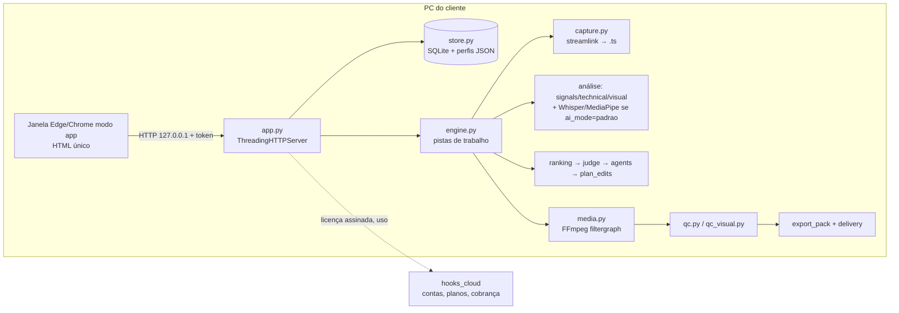
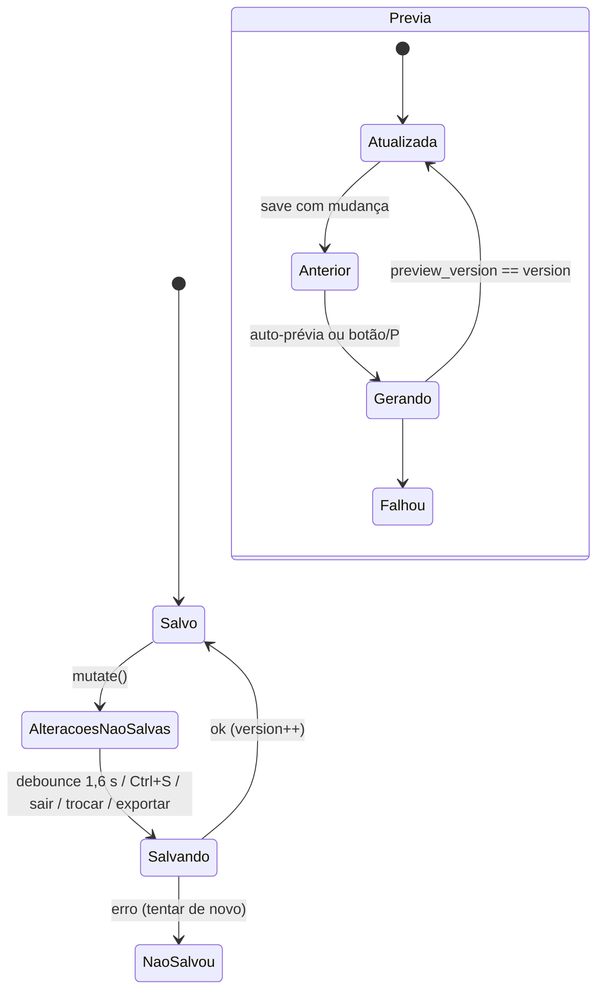
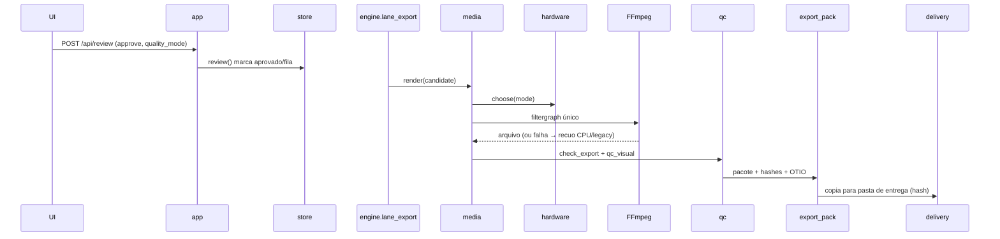

# HOOKS — Handoff técnico (estado operacional em 23/11/2026)

Para o engenheiro (ou nova instância do Claude Code) que assume. Complementa `CLAUDE.md` (regras) e `HOOKS_MASTER_DOSSIER.md` (história). Confiança: **[VERIFICADO NO CÓDIGO]** lido nesta análise · **[TESTADO]** executado · **[NÃO VERIFICADO]**.

## 1. Estado atual

- **Última versão confirmada:** `0.19.0-beta.1` (`liveclips/__init__.py`, `hooks_cloud/__init__.py`). ZIP: `Hooks-0.19.0-beta.1.zip` (2,3 MB, 316 arquivos: `liveclips/` 99 arquivos, `tests/` 111, `validacao/` 30, `hooks_cloud/` 18).
- **Base preservada:** `0.18.2-beta.1` (`/home/claude/work/v9`, ZIP `Hooks-0.18.2-beta.1.zip`). Desenvolvimento em `/home/claude/work/v10`, fontes de UI em `/home/claude/work/ui10`. **Esses caminhos são do ambiente de trabalho do assistente (Linux), que pode ser efêmero**; o que o usuário possui são os ZIPs entregues. As fontes da UI **não** estão dentro do ZIP da 0.19: use o pacote `HOOKS_UI_SOURCES_0.19.zip` que acompanha esta documentação.
- **Redesign solicitado (Request 4):** concluído nesta execução em E0, E1, E2 e E3/E4 (ver tabela no dossiê §Parte VII); E5–E10 parcialmente ou pendentes (roadmap).
- **Testes (rodados em Linux, Python 3.13, FFmpeg do sistema, Chrome headless, mídia sintética):**
  - Suíte completa da 0.19: **1212 casos, 1211 OK + 1 falha** (teste antigo que exigia a palavra "Agente"); depois da correção, os módulos relacionados (interface, HTTP, salvar/prévia, modos, instaladores, sem IA) passaram [relato da sessão anterior, TESTADO]. **Não houve nova rodada completa depois da correção** — isso é pendência de confirmação.
  - Nesta sessão de documentação reexecutei `test_salvar_previa`, `test_modos_qualidade`, `test_noai_mode`: **24 testes OK em 68 s** [TESTADO hoje].
  - e2e do Estúdio (`validacao/e2e_estudio_0_19.py`): 28 verificações OK (sessão anterior).
- **Testes falhando conhecidos:** nenhum registrado na última rodada, além da falha já corrigida. **Não validado:** Windows real, GPU (NVENC/QSV/AMF), live real, YouTube real, Asaas/SMTP/HTTPS, OTIO em NLE, pessoas.
- **Dependências externas:** FFmpeg/ffprobe (winget no Windows), Python 3.11, faster-whisper 1.2.1 (CUDA exige cuBLAS/cuDNN), streamlink 8.6.3, opencv-contrib 4.10.0.84, mediapipe 0.10.21, yt-dlp ≥2026.10.26 (+ Deno/Node para YouTube), cryptography ≥42; opcionais: RNNoise (baixado uma vez), Ollama.
- **Componentes obsoletos / inconsistências:** `body.old.html`, `style.old.css` e vários `e2e*.py`/`shot*.py` em `ui10/` são rascunhos; docstring de `__init__.py` ainda diz 0.13; vários `.md` antigos do pacote (`PENDENCIAS_0_16`, `CHECKPOINT_*`) citam números superados.

## 2. Como executar

```bash
# Linux/macOS (desenvolvimento)
cd <pasta com liveclips/>
python3 -m liveclips --root /tmp/hk --port 8765 --no-browser     # painel em http://127.0.0.1:8765
# flags: --root, --port (8765), --no-browser, --legacy-root; variável LIVECLIPS_ROOT
# Windows (usuário): INSTALAR.bat (cria .venv, instala requirements, FFmpeg, atalho) → ABRIR_LIVECLIPS.bat (console) ou atalho Hook's (janela sem console)
# SaaS local: SAAS_LOCAL.bat (admin em http://127.0.0.1:8800/admin) | DESLIGAR_SAAS_LOCAL.bat
# Diagnóstico: python -m liveclips diag | GERAR_DIAGNOSTICO.bat
# Benchmark: python -m liveclips bench
```
Testes: ver `CLAUDE.md`. Interface: `ui/build.sh` regenera `liveclips/static/index.html` e roda `node --check` no JS (`BUILD_OK`). Os scripts de `ui10` têm caminhos absolutos `/home/claude/work/...`: **ajuste-os** (`build.sh`, `fresh.sh`, `seed.py`) ao novo local.

## 3. Arquitetura

### 3.1 Visão geral [VERIFICADO NO CÓDIGO]



- **Linguagens:** Python (backend, ~20,5 mil linhas em 96 módulos), JavaScript/HTML/CSS (UI, ~265 KB de fontes → 289 KB gerados), Batch/PowerShell (instaladores).
- **Processos/threads:** um processo do servidor; `Engine.start()` cria 6 threads daemon (`principal` + `analise`, `edicao`, `exportacao`, `exportacao2`, `refino`); modo `lanes=unico` usa só a principal. `ModelGate` serializa o uso do modelo de voz (análise tem prioridade). Cada captura é um processo de Streamlink. FFmpeg/ffprobe são subprocessos. Instância única por pasta (lock `liveclips_v8.lock`).
- **Comunicação:** API JSON em `/api/*` (~80 rotas em `app.py` e `studio_api.py`), cabeçalho `X-LiveClips-Token` ou cookie `lc_session`; estado do painel com `X-State-Tag` (resposta "sem mudança"); interface consulta a cada 2,5 s quando visível.
- **Persistência:** SQLite (`streamers, sessions, segments, centers, candidates, events, settings`), perfil por streamer, memória editorial em `memoria_editorial.sqlite3`, escrita atômica (`atomic.py`), render em pasta temporária e troca atômica.
- **Estado do corte:** `candidates.version` (versão do projeto) × `preview_version` (de qual versão é a prévia) × `preview_status` (`queued/ready/...`) — ver §3.4.

### 3.2 Fluxo de ponta a ponta [VERIFICADO NO CÓDIGO]
1. **Abrir:** `__main__.main()` → `single_instance(root)` → `App` + `server`; `desktop.py` (atalho) sobe o servidor escondido e abre a janela. 2. **Interface:** `GET /` devolve `static/index.html` com `__BOOT_TOKEN__` substituído; `refresh()` chama `/api/state`.
3. **Importar:** `/api/video/import|url`, `/api/upload`, `/api/capture/start` → `store.new_session`, segmentos em `segments`.
4. **Analisar:** `engine.analyze_one` (Whisper + `signals.extrair`) ou `_analyze_free` (sem IA) → `engine.suggest_one` → `ranking.rank` → `judge.curate` → `plan_edits` → `store.propose` (cria candidato).
5. **Selecionar/editar:** `/api/project/get` devolve projeto + `preview_timing` (de `editing.timing_for`) + `preview` (`app.preview_info`) + catálogo de modos; o Estúdio altera `ST.proj` com `mutate()` (desfazer de 80 níveis).
6. **Salvar:** `/api/project/save` → `store.save_project(learn=...)`: sobe `version`, mantém a prévia antiga como "stale", enfileira nova prévia; autosave ~1,6 s com `learn=False`.
7. **Prévia:** pista `edicao` → `engine.do_render(preview=True)` → `media.render(draft)` 540×960 libx264 ultrafast; ao concluir grava `preview_timing`.
8. **Aprovar/exportar:** `/api/review` (approve/retry, aceita `quality_mode`) → pista `exportacao` → `engine.do_render` → `media.render` → `_render_single` (um filtergraph) → `_render_variants` (1:1, 4:5, 16:9) → QC → pacote (`plano.json`, `revisao.json`, `pacote.json`, OTIO) → pasta de entrega.
9. **Encerrar:** botão "Encerrar Hook's" (`/api/app/quit`) para gravações, fecha e apaga `servidor.json`; fechar a janela com trabalho ativo mantém em segundo plano (e se a janela fecha em <8 s, não encerra).

### 3.3 Multimídia [VERIFICADO NO CÓDIGO]
- `media.render(candidate, transcript, session_path, preview, pipeline)` → `plan_pieces` (trechos, replay/freeze) → `build_source` (concat) → `audio_chain` → legenda ASS (libass) → `_video_codec(profile, draft, meta)` → comando FFmpeg único. Falhou → `_render_legacy` (método V7, sem módulos opcionais) e grava o motivo no manifesto.
- **Encoders:** `hardware.choose(preference, draft, force_cpu, mode)` testa NVENC/QSV/AMF com um encode real e recua para x264. Modos em `telemetry.MODES` (CPU) e `hardware.GPU_MODES`; manifesto grava `quality_mode` e `video_args`.
- **Layout vertical live:** webcam 640 px no topo + jogo 1280 px; vídeo: ajustar ou preencher com fundo desfocado. Fontes ≤2560×1440 preservadas; 60 fps se a fonte ≥50 fps; Lanczos.
- **Cache:** `cache.py` por SHA-256 + parâmetros (análise técnica). **Falhas:** `LowSpace` pausa a pista; retries de análise em 30 s/2 min/5 min; render atômico; limpeza de `render_*` ao abrir.

### 3.4 Máquina de estados de salvamento e prévia (0.19)

`preview_info`: `ready` = prévia da versão atual; `stale` = arquivo anterior em disco ainda tocável (com `preview_timing` guardado para posicionar o cursor); `available = ready or stale`.

### 3.5 Exportação


## 4. Bugs e riscos conhecidos

| Item | Situação |
|---|---|
| Desfazer guarda JSON completo a cada ação (até 80) | Pode pesar em cortes longos [NÃO MEDIDO] |
| Redesenho: lista de fala e inspetor aberto redesenham a cada mudança | N5 parcial |
| Prévia = render do clipe inteiro (~9–10 s p/ 14 s aqui) | A02 |
| Legenda ao vivo (HTML) ≠ legenda final (libass) | Aproximação; comparar lado a lado |
| `body.old.html`/`style.old.css`, scripts `e2e*`, `shot*` em `ui10/` | Rascunhos; limpar |
| Perfil novo nasce em `padrao` (com IA) e `requirements.txt` instala Whisper/MediaPipe | Decisão A01 |
| Último pedaço de live com <128 KB e <3 s não é cadastrado | Aceito |
| Ajustes de GPU p7/hq/veryslow/QP17-19 podem ser recusados por drivers antigos | Recuo para CPU |
| Única fila de transcrição | Gargalo com várias lives |
| Dados de teste em `/tmp/*` | Efêmeros |
| Segurança do app local: token por sessão, 127.0.0.1 | Não houve auditoria de segurança do app (só do servidor SaaS: 55 verificações + ~14.500 entradas inválidas) |

## 5. Armadilhas operacionais (aprendidas)
- Playwright: o CSP bloqueia avaliação de string em `wait_for_function`; usar polling com `evaluate`. Usar `/usr/bin/google-chrome`.
- `fresh.sh`: se a porta ficar presa, dormir 3 s e trocar de porta.
- Sempre rodar `ui/build.sh` depois de mexer em `ui/*`; ele valida a sintaxe do JS.
- `test_interface` confere nomes na tela ("Sugestões", seções "Cortes e efeitos", "Layout e imagens", "Por quê") e proíbe a palavra "'Agente'".
- A suíte completa leva ≈39 min: rodar em segundo plano (`nohup`).
- Windows: `.bat` com `chcp 65001`; não editar com ferramentas que convertam finais de linha sem conferir.

## 6. Próximas tarefas
Ver `HOOKS_ROADMAP.md`. Sequência sugerida: C03 (fontes da UI no repo) → C04 (git) → C01/C02 (Windows e GPU, com o Rafael) → A03/A04/A05 (timeline, atalhos, design system) → A02 (prévia em camadas, com protótipo) → decisão A01.
